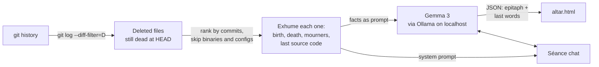

<div align="center">


[](https://dev.to/paulopnun/git-afterlife-i-held-a-seance-for-the-original-flaskpy-36o5)
[](https://paulopnun.github.io/git-afterlife/)
[](https://paulopnun.github.io/git-afterlife/seance.txt)
[](https://github.com/PauLopNun/git-afterlife/actions/workflows/afterlife.yml)


[](https://dev.to/challenges/hacktoberfest-week4-2026-10-26)

<br>


<br><br>

<a href="https://paulopnun.github.io/git-afterlife/"></a>

</div>

<br>

<p align="center"></p>

Every repository has a graveyard: files born in a hopeful first commit, carried
through dozens of refactors, and finally deleted with a one-line commit message.
Nobody remembers them.

**git-afterlife** digs them out of your git history and builds them an altar, an *ofrenda*,
the altar families raise on Día de los Muertos to welcome back the ones they
lost. Each deleted file gets a place on the altar with its birth date, its death
date, the people who touched it, the commit that killed it, and an epitaph with
its last words, written by an **open-weight model running on your own machine**.

You can also hold a **séance** and talk to the ghost of a deleted file. It
remembers its real code, who created it, and why it was removed.

<div align="center">

| `summon` | `seance` |
| :---: | :---: |
| Builds a self-contained HTML altar with papel picado, flickering candles, falling marigold petals and recorded séances | Opens a conversation with one dead file, which answers in first person from its real code and history |

</div>

<p align="center"></p>

<p align="center"></p>

## Hall of the dead

The most famous souls on the [Flask altar](https://paulopnun.github.io/git-afterlife/), straight from its git history:

| The deceased | Lived | Commits | Killed by | Cause of death |
| --- | --- | :---: | --- | --- |
| `flask.py` | 2010-04-06 → 2010-07-02 | 104 | Justin Quick | `out with the old` |
| `tests/flask_tests.py` | 2010-04-14 → 2011-08-26 | 134 | Armin Ronacher | `Split up testsuite and moved it to flask.testsuite` |
| `setup.py` | 2010-04-06 → 2023-01-18 | 121 | David Lord | `switch to pyproject.toml` |
| `docs/deploying/fastcgi.rst` | 2010-04-19 → 2022-06-12 | 32 | David Lord | `rewrite deployment docs` |

## The challenge

<div align="center">


</div>

This project was built for the **Hacktoberfest 2026 Open-Source AI Challenge,
Week 4: _Ghost in the Machine_** on DEV, whose prompt is to build something with
open-source AI at its core, either spooky or in the spirit of Día de los Muertos.

**Read the full write-up on DEV: [git-afterlife: I Held a Séance for the Original flask.py](https://dev.to/paulopnun/git-afterlife-i-held-a-seance-for-the-original-flaskpy-36o5)**

| What the prompt asks | How git-afterlife answers it |
| --- | --- |
| Open-source AI at the core | Every epitaph and every séance answer comes from **Gemma 3**, an open-weight model, served by **Ollama**. There is no cloud API anywhere in the code |
| Spooky, or honoring the past | It is literally a Día de los Muertos altar: it honors the files a project lost and lets you speak with their ghosts |
| Why open matters | See [Why local and open](#why-local-and-open) |

## Why local and open

- **Your code stays home.** Source code is often the one thing you are not
  allowed to paste into a cloud chatbot. git-afterlife only talks to Ollama on
  `localhost`, so private repositories never leave the machine.
- **It works with the lights (and the internet) off.** Once the model is pulled,
  everything runs offline.
- **It costs nothing to run.** Gemma 3 4B runs on a laptop CPU, and a whole
  altar is generated for free inside a standard GitHub Actions runner.
- **Swap the medium.** Any Ollama model works with `--model`, from a 1B model on
  a laptop to a large one on a GPU.

## Quick start

```bash
# 1. Install Ollama (https://ollama.com) and pull the model
ollama pull gemma3:4b        # or gemma3:1b on an older machine: faster, less poetic

# 2. Get git-afterlife (standard library only, nothing to pip install)
git clone https://github.com/PauLopNun/git-afterlife.git
cd git-afterlife

# 3. Raise an altar for any repository
python3 afterlife.py summon /path/to/repo
xdg-open altar.html
```

Talk to one of the dead:

```bash
python3 afterlife.py seance flask.py ~/src/flask
```

```text
The candles flicker. The spirit of flask.py (2010-04-06 – 2010-07-02) is listening.
Ask your questions. Type 'bye' to let it rest.

you › Why did they delete you?
spirit › It was Justin Quick, you see. A single commit, a dismissive message: "out
         with the old." He simply… deleted me. My last known state, the one I clung
         to, vanished with that commit. It was a strange, sudden end for a fledgling
         framework.
```

*A real answer from the [demo séance](https://paulopnun.github.io/git-afterlife/seance.txt), by Gemma 3 4B.*

## Options

| Option | Default | What it does |
| --- | --- | --- |
| `--model` | `gemma3:4b` (or `$AFTERLIFE_MODEL`) | Any Ollama model |
| `--lang` | `English` | Language the dead speak, e.g. `--lang French` |
| `--limit` | `10` | How many souls to raise (`summon`) |
| `--seances` | `3` | Hold a recorded séance with the first N souls and show it on the altar (`summon`) |
| `--out` | `altar.html` | Output file (`summon`) |
| `--dry-run` | off | Dig up the files without asking the model (`summon`) |

`OLLAMA_HOST` is honored if Ollama runs on another machine.

## How it works



1. `git log --diff-filter=D` lists every file ever deleted. Files that came back
   to life at `HEAD` are skipped, and so are binaries.
2. The longest-lived source files are raised first, measured by how many commits
   touched them. Lock and config files are left to rest.
3. For each one it recovers its birth commit, its death commit, everyone who
   touched it, and its last known source (`git show <death>^:<path>`).
4. Those facts go to the local model, which answers in JSON with an epitaph and
   the file's last words. **The cause of death is never invented**: it is the
   real commit message that deleted the file.
5. The first few souls are also interviewed in a short séance, using the same
   grounded prompt as the interactive `seance` command, and the conversation is
   shown on their card.
6. Everything is rendered into one self-contained HTML page with no external
   requests.

## Live demo, built by GitHub Actions

The [workflow](.github/workflows/afterlife.yml) installs Ollama on a GitHub
runner, pulls Gemma 3 4B, clones [Flask](https://github.com/pallets/flask), raises
its altar, holds a séance with the original
single-file `flask.py` (2010), takes screenshots with headless Chrome, records
the séance GIF with [VHS](https://github.com/charmbracelet/vhs), and publishes
everything to GitHub Pages:

- [The altar](https://paulopnun.github.io/git-afterlife/)
- [The séance transcript](https://paulopnun.github.io/git-afterlife/seance.txt)

You can run it for any public repository from **Actions → Raise the altar →
Run workflow**, choosing the repository and the model.

## Project structure

```text
git-afterlife/
├── afterlife.py                     # the whole tool: git archaeology, Ollama client, altar, séance
├── tests/
│   └── test_afterlife.py            # builds a tiny graveyard and checks every step with a fake model
├── docs/
│   ├── cover.html                   # source of the cover image
│   └── seance.tape                  # VHS script that records the séance GIF
├── .github/workflows/afterlife.yml  # tests on every push; builds and deploys the live demo on demand
├── README.md
└── LICENSE
```

## Tests

```bash
python3 -m unittest discover -s tests -v
```

The tests create a real git repository with births, deaths, a binary and a file
that comes back to life, and replace the model with a fake medium, so they run
in a fraction of a second without Ollama. They run on every push and pull request.

## License

[MIT](LICENSE) © 2026 Pau López Núñez

<div align="center">


</div>
